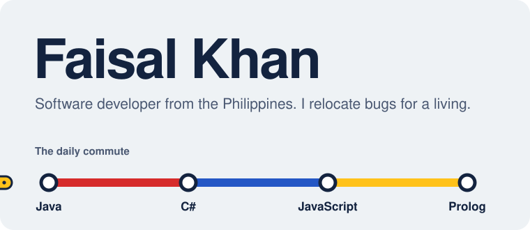
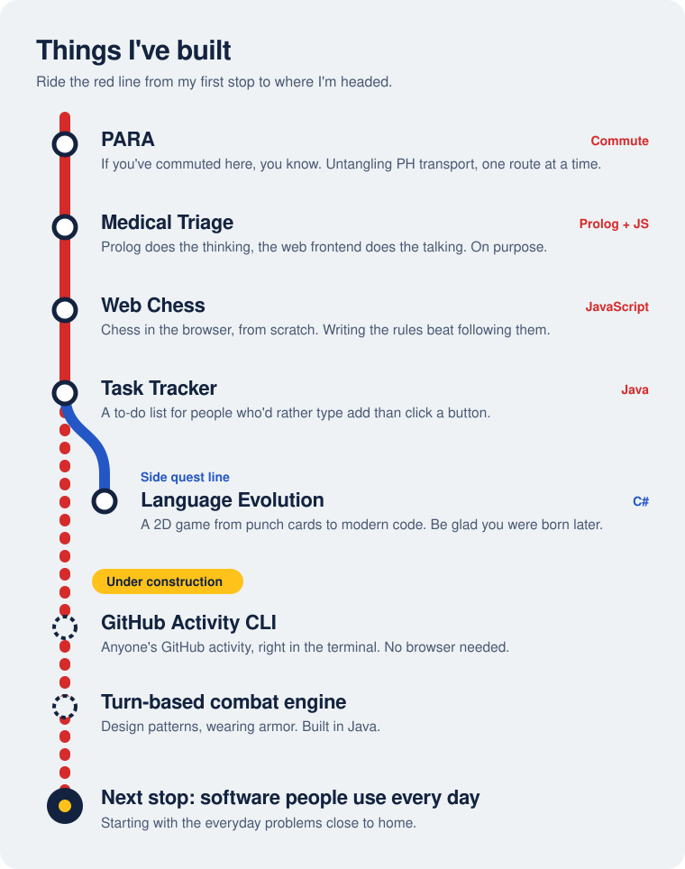

I write Java when I want structure, JavaScript when I want chaos, and C# when I'd rather build a game than do what I'm supposed to be doing. Whatever the language, I care about what's underneath: code that reads as clearly as it runs, on the second or third try.

Hop on at any stop: [PARA](https://github.com/faideleon/PARA---Transportation-GPS), [Medical Triage](https://github.com/faideleon/Medical-Triage-using-Prolog), [Web Chess](https://github.com/faideleon/web-based-chess-game), [Task Tracker](https://github.com/faideleon/CLI-Task-Tracker) or [Language Evolution](https://github.com/faideleon/Programming-Language-Evolution-Based-Game).

&nbsp;&nbsp;
