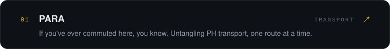
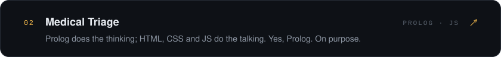
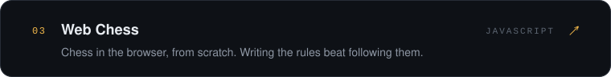
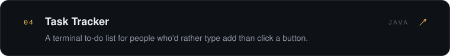
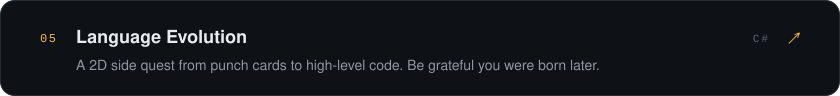
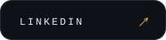

Hey, I'm Faisal. I write **Java** when I want structure, **JavaScript** when I want chaos, and **C#** when I want to make a game instead of doing what I'm supposed to be doing. Underneath all of it, I care about the architecture: code that reads as clearly as it runs.

Where I'm headed: building software real people use every day, the kind that makes everyday problems a little smaller, especially the ones close to home.

&nbsp;&nbsp;
